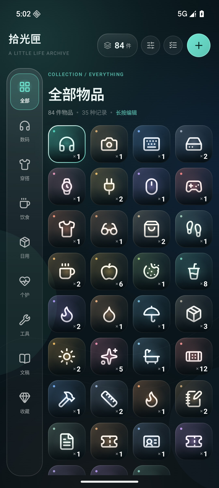
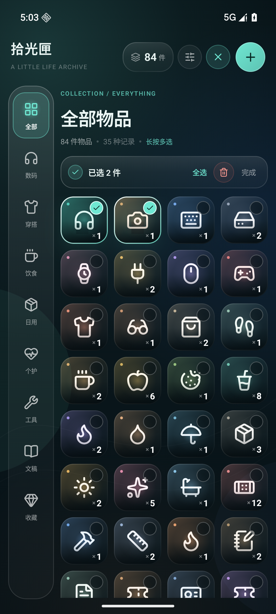
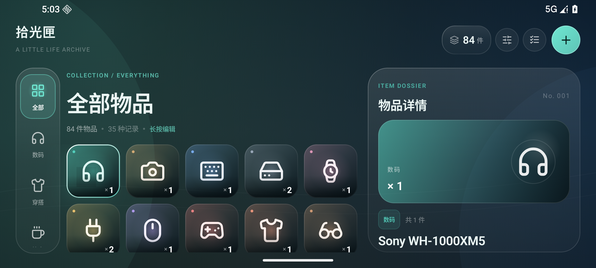
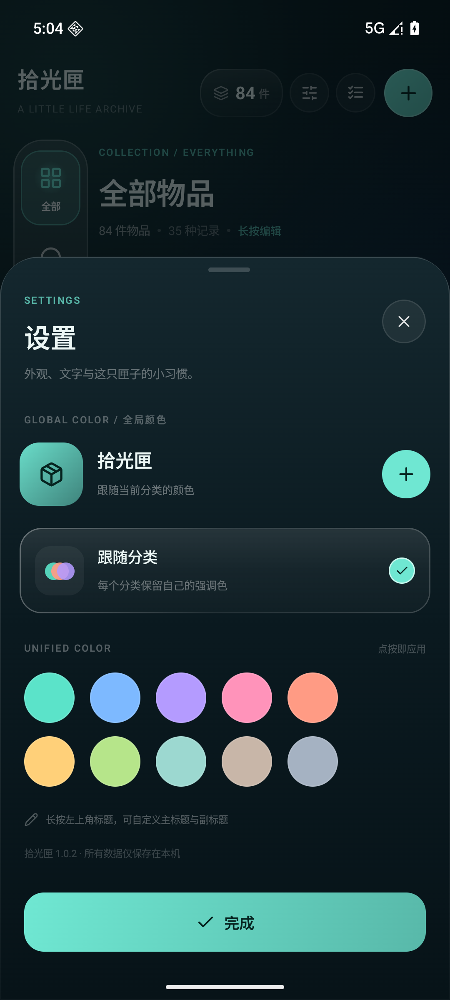
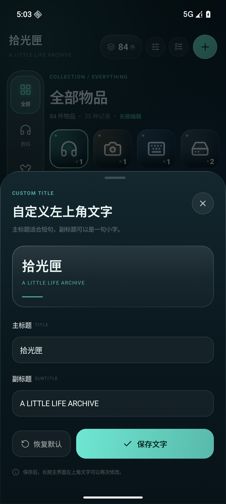
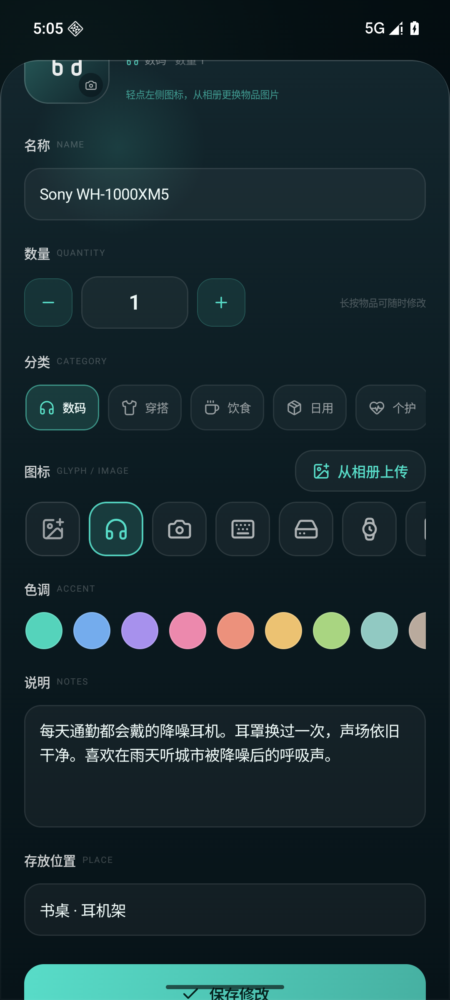

# 拾光匣 · Shiguang Box

把现实生活中真正拥有的物品，收进一只安静、好看的匣子。

拾光匣是一款面向日常收纳与物品管理的 Android 应用。它以《原神》等二次元游戏的背包信息层级为灵感，并结合 ColorOS 17 风格的暗色玻璃质感、动态强调色与大圆角卡片，做成一个真正可以每天使用的物品记录工具。

## 预览

| 竖屏主界面 | 多选模式 | 横屏三栏 |
| --- | --- | --- |
|  |  |  |

| 设置与全局颜色 | 自定义左上角文字 | 自定义物品图标 |
| --- | --- | --- |
|  |  |  |

> 截图来自 Android 36 模拟器，界面同时适配竖屏与横屏。横屏下会自动展开右侧物品档案面板。

## 功能

- **分类导航**：左侧玻璃分类栏，内置「全部」「数码」「穿搭」「饮食」「日用」「个护」「工具」「文稿」「收藏」。
- **自定义分类**：新建分类，修改名称、图标、强调色；图标可从内置线性图标库选择，也可从相册上传自定义图片。
- **物品网格**：与参考图一致的方形物品格、底部对齐的大号数量、选中白边与强调色光晕；4 列竖屏 / 5 列横屏自适应。选中物品与分类不再显示装饰圆点。
- **物品档案**：点按物品查看名称、分类、数量、说明、存放位置与录入日期。
- **多选模式**：右上角清单按钮进入多选；点按或长按物品连续选择，支持全选/全不选、批量删除，返回键或「完成」退出。
- **长按编辑**：长按任意物品直接打开编辑面板，可修改：
  - 名称
  - 数量（步进器 + 数字输入）
  - 分类
  - 图标（内置图标库或相册上传）
  - 强调色
  - 文本说明
  - 存放位置
- **新建入口**：右上角 `+` 同时提供「新建物品」和「新建分类」。
- **总数统计**：右上角实时显示所有物品的总件数；分类页显示当前分类的件数与记录数。
- **设置**：右上角设置按钮打开设置面板，包含完整的全局调色盘；可在「跟随分类」和「统一主题色」之间切换，统一主题色会即时应用到极光背景、顶部按钮、分类高亮与页面强调色，并持久保存。
- **自定义左上角文字**：左上角去掉按钮，只保留标题文字；长按标题可编辑主标题与副标题，并持久保存。
- **本地持久化**：分类、物品、全局主题色、自定义标题与自定义图片全部保存在设备本地，不联网、不上传。
- **删除保护**：删除物品/分类前有二次确认；删除分类时，物品会移动到「其他」，不会丢失。
- **细节优化**：左侧分类栏底部略微收短；编辑器图标行首提供「自定义图标」入口，可直接从相册上传图片。
- **响应式布局**：
  - 竖屏：分类栏 + 物品网格，详情/编辑器以底部玻璃面板呈现。
  - 横屏或宽屏：分类栏 + 网格 + 右侧物品档案三栏布局。

顶部没有多余的搜索框，底部没有底部导航栏；保留参考图中干净、克制的内容结构。

## 技术信息

| 项目 | 值 |
| --- | --- |
| applicationId | `com.miraitowa.shiguang` |
| 最低系统 | Android 9 / API 28 |
| 编译 SDK | API 37 |
| targetSdk | **37** |
| UI | Jetpack Compose + Material 3 |
| 构建 | AGP 9.4.1 · Gradle 9.6.0 · Kotlin 2.4.x（AGP 内置） |
| 数据 | SharedPreferences + JSON，自定义图片存储于应用私有目录 |
| 网络权限 | 无 |
| 设计语言 | ColorOS 17 启发的暗色玻璃、极光渐变、动态分类色 |

## 构建

### 环境

- JDK 17 或更高版本（本工程使用 JetBrains Runtime 25 验证）
- Android SDK Platform 37.0
- Android SDK Build-Tools 36.0.0（AGP 9.4 默认）
- Gradle 9.6.0（工程包含 wrapper）

### 命令

```bash
export ANDROID_HOME=/path/to/android-sdk
export JAVA_HOME=/path/to/jdk

./gradlew :app:assembleDebug
```

产物：

```text
app/build/outputs/apk/debug/app-debug.apk
```

本工程已附上构建好的可安装包：

```text
dist/ShiguangBox-1.0.2.apk
```

该 APK 使用 Android Debug 签名，适合直接侧载测试。SHA-256 见 `dist/SHA256SUMS.txt`。

### 在本机直接安装

```bash
adb install -r app/build/outputs/apk/debug/app-debug.apk
adb shell am start -n com.miraitowa.shiguang/.MainActivity
```

> 首次启动会写入一份示例拾光匣数据。卸载应用或在系统设置中清除数据即可恢复示例内容。

## 目录结构

```text
app/src/main/java/com/miraitowa/shiguang/
├── MainActivity.kt                 # Edge-to-edge、系统栏、入口
├── data/
│   ├── Models.kt                   # Category / InventoryItem / 统计
│   ├── SeedData.kt                 # 首次启动示例数据
│   ├── InventoryStore.kt           # JSON 本地持久化与增删改
│   └── IconCatalog.kt              # 内置图标库与强调色
├── ui/
│   ├── InventoryApp.kt             # 根状态与面板调度
│   ├── InventoryScreen.kt          # 分类栏、网格、物品卡、详情面板
│   ├── ItemEditorSheet.kt          # 物品编辑器
│   ├── CategoryEditorSheet.kt      # 分类编辑器
│   ├── GlobalColorSheet.kt         # 设置面板（含全局调色盘）
│   ├── AppTitleEditorSheet.kt      # 左上角文字编辑器
│   ├── Sheets.kt                   # 新建菜单 / 竖屏详情面板
│   ├── components/                 # 玻璃面板、图标、背景、系统栏
│   └── theme/                      # 色彩、字体、形状
└── util/ImageStorage.kt            # 相册图片导入与缩略图解码
app/src/main/res/drawable/          # 本地矢量线性图标
```

## 数据与隐私

- 所有数据仅保存在本机 `SharedPreferences` 中，包括全局主题色与自定义标题。
- 相册图片导入后会缩放并复制到应用私有目录 `files/item_images/`，原图不会被修改。
- 应用不申请网络权限，不上传任何内容。
- 卸载应用会删除应用内数据；如需长期保存，请自行备份。
